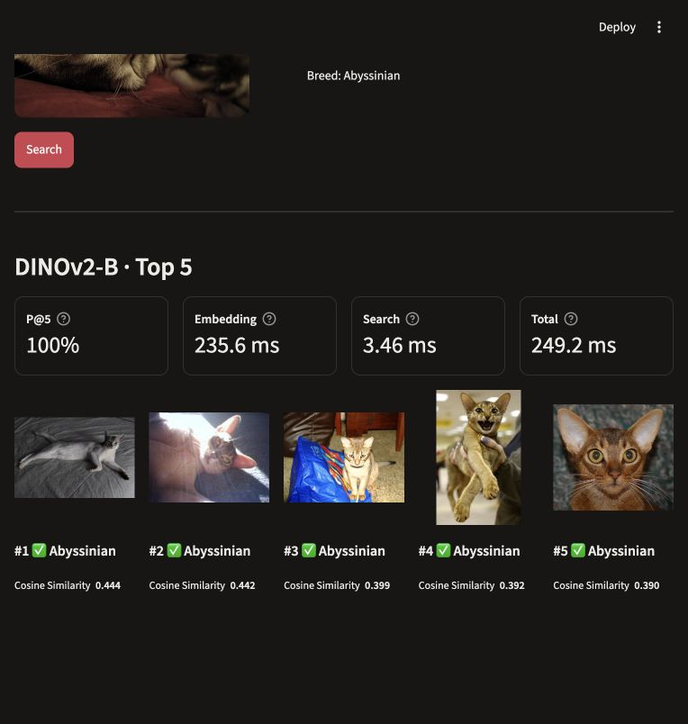

# Visual Retrieval System

## Project overview

An image-search system that retrieves the five most visually similar images from the [Oxford-IIIT Pet](https://www.robots.ox.ac.uk/~vgg/data/pets/) dataset. The project compares self-supervised DINO and DINOv2 embeddings with supervised DeiT embeddings using retrieval quality and runtime measurements.

The interface supports image uploads, prepared examples, single-model search, and comparison of all four models.

## Repository layout

| Location | Contents |
| --- | --- |
| [`demo/`](demo/) | Streamlit interface, prepared examples, screenshot, and setup instructions. |
| [`notebooks/`](notebooks/) | Three notebooks for model evaluation and final analysis. |
| [`results/`](results/) | Saved quality metrics, runtime measurements, figures, and failure cases. |
| [`docs/`](docs/) | Project plan, milestone reports, and final submission documents. |
| [`configs/`](configs/) | Shared experiment settings and fixed dataset split. |
| [`scripts/`](scripts/) | Dataset preparation, evaluation, timing, demo preparation, and final-analysis entry points. |
| [`src/`](src/) | Shared dataset, model, embedding, retrieval, metric, and timing code. |
| [`requirements.txt`](requirements.txt) | Combined project dependencies. |

For detailed information about the experiments, see the reports in [`docs/milestones/`](docs/milestones/).

For the final project summary and team contributions, see the [technical summary (PDF)](docs/final/technical_summary.pdf) or its [Word version](docs/final/technical_summary.docx). The [presentation (PowerPoint)](docs/final/presentation.pptx) includes the demo video; a [PDF version](docs/final/presentation.pdf) is also available.

## Demo and results

To run the system and view live retrieval results, follow the step-by-step instructions in [`demo/README.md`](demo/README.md). They cover environment setup, gallery and model preparation, and launching the interface.

For saved experiment tables, timings, comparison charts, and failure examples, see [`results/README.md`](results/README.md).

## Reproduce the experiments

Open a notebook from [`notebooks/`](notebooks/) in Kaggle, Colab, or local Jupyter and run its cells in order. The notebooks download the repository when needed and install dependencies.

**Internet access must be enabled. A GPU is recommended for model evaluation; notebook 02 requires a CUDA GPU. Notebook 03 runs on CPU.**

| Notebook | Purpose |
| --- | --- |
| [01 — First models](notebooks/01_first_models_colab.ipynb) | Evaluate DINO ViT-S/16 and supervised DeiT-S/16; GPU recommended. |
| [02 — Second models](notebooks/02_second_models_colab.ipynb) | Compare all four models, repeat timing measurements, and export embeddings; CUDA GPU required. |
| [03 — Final analysis](notebooks/03_final_analysis.ipynb) | Assemble final tables and charts, validate saved failure cases, and package the results; CPU sufficient. |
