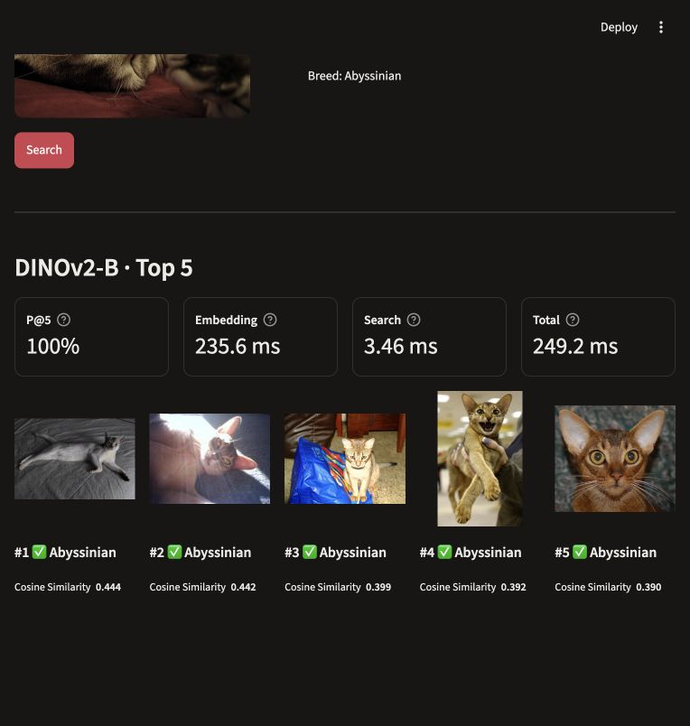

# Image Similarity Search and Model Comparison

## Description

This Streamlit demo retrieves the five most similar images from a fixed gallery of 1,840 [Oxford-IIIT Pet](https://www.robots.ox.ac.uk/~vgg/data/pets/) images using pretrained image embeddings.

- Upload a JPG/PNG image or choose one of four prepared examples.
- Search with **DINO-S**, **DeiT-S**, **DINOv2-B**, or **DeiT-B**, or compare all four models on the same query.
- View the Top-5 images, breed labels, and cosine similarity scores. In comparison mode, switch between models using **View results**, **Previous**, and **Next**.
- View live embedding, search, and total timings (total includes preprocessing). Prepared examples also show query-level **Precision@5**; arbitrary uploads have no assumed breed or quality score.



The app performs live query embedding and exact cosine search against saved gallery embeddings. It uses frozen pretrained encoders and does not train models. Model loading is cached and excluded from the displayed timings.

## Setup

1. Clone the repository and enter its root directory:

   ```bash
   git clone https://github.com/kite121/Visual_retrieval_system.git
   cd Visual_retrieval_system
   ```

2. Create and activate a Python environment, then install dependencies. Python 3.12 was used for local verification; CUDA is optional. The activation command below is for macOS/Linux.

   ```bash
   python3.12 -m venv .venv
   source .venv/bin/activate
   python -m pip install -r requirements.txt
   ```

3. Obtain `second_models_embeddings.zip`, exported by [notebook 02](../notebooks/02_second_models_colab.ipynb). This generated archive is not stored in Git. Prepare the gallery, dataset images, and pretrained weights with internet access:

   ```bash
   python scripts/prepare_demo.py --embeddings-zip /path/to/second_models_embeddings.zip --verify-models
   ```

   Replace the archive path with its actual location. The command checks the split manifest, installs gallery caches in `demo/embeddings/`, downloads Oxford-IIIT Pet images into `data/`, and caches model weights in `demo/.cache/`. `--verify-models` runs all four prepared examples through all four models and records their observed outputs. If gallery caches are already installed, omit `--embeddings-zip`.

4. Start the app from the repository root:

   ```bash
   streamlit run demo/app.py
   ```

5. Open [http://localhost:8501](http://localhost:8501), select **One model** or **Compare 4 models**, choose **Example** or **Upload**, and press **Search**.

For later launches, activate the same environment and repeat step 4. Prepare assets on the presentation machine in advance; after successful preparation, retrieval can run offline. Dataset images, gallery vectors, and weights are local assets ignored by Git. Example images and their descriptions in `example_queries/cases.json` are versioned.
